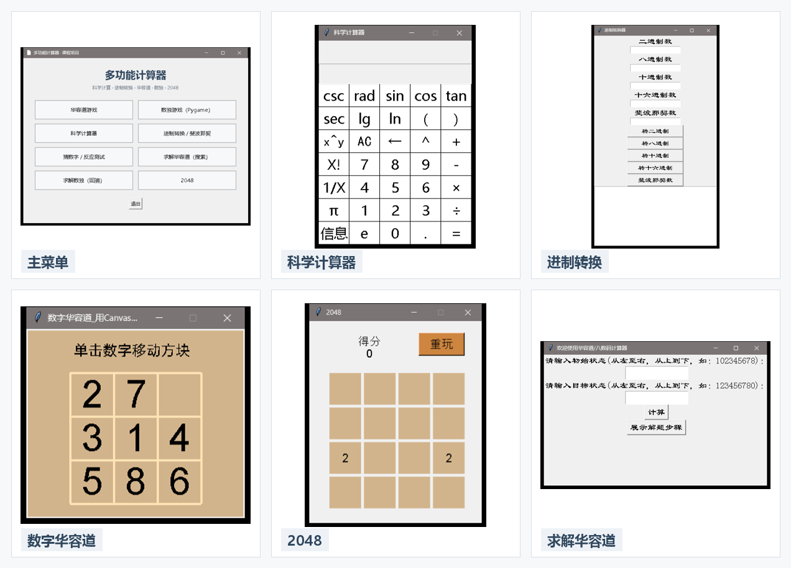
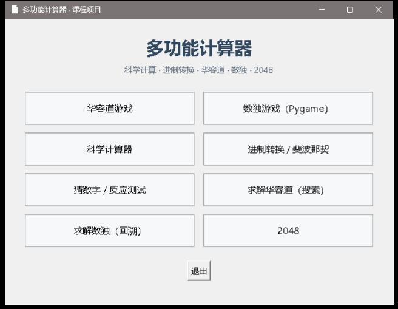
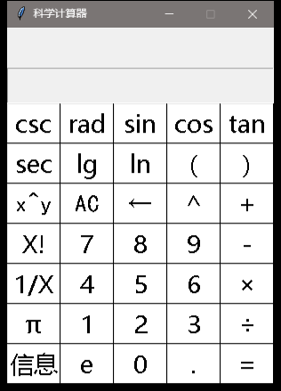
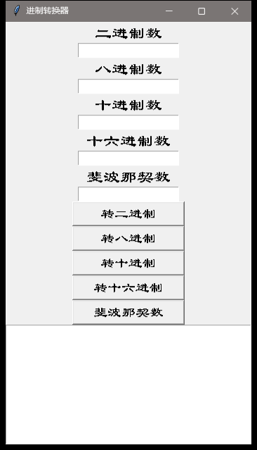
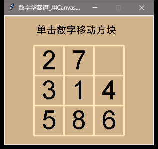
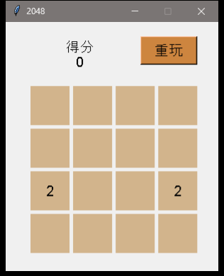
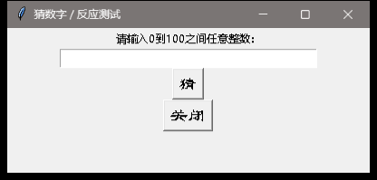
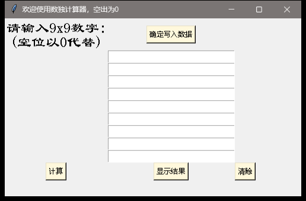
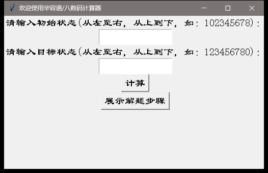

# 多功能计算器 · Python 桌面应用

> Python + Tkinter + Pygame 的桌面小工具合集：科学计算器、进制转换、数字华容道、数独、2048 和猜数字。  
> 软件工程课程两人小组项目（安津毅 + 向怡然）的整理版。



## 项目简介

这是一个可以从一个主菜单进入多个小程序的桌面应用：

- 科学计算器（三角函数、指数、对数、阶乘、π/e 等）；
- 进制转换（2/8/10/16 进制）与斐波那契数计算；
- 数字华容道（Tkinter Canvas）；
- 数独游戏（Pygame）与数独求解器（回溯）；
- 华容道/八数码求解器（搜索 + 步骤展示）；
- 2048；
- 猜数字与反应速度测试。

运行入口是 `FirstPage.py`。整理时把启动方式从 `os.system('python ...')` 改成 `subprocess.Popen([sys.executable, ...])`，所以从任意目录启动、以及在 venv 里运行都不会找不到 Python。

## 功能截图

| 主菜单 | 科学计算器 | 进制转换 |
|---|---|---|
|  |  |  |

| 数字华容道 | 2048 | 猜数字 |
|---|---|---|
|  |  |  |

数独求解器与华容道求解器：

| 数独（回溯） | 华容道/八数码（搜索） |
|---|---|
|  |  |

## 快速开始

要求：Python 3.10+；Windows 推荐（Tkinter 随 Python 一起安装）。

```bash
python -m venv .venv
source .venv/Scripts/activate        # Git Bash on Windows
pip install -r requirements.txt
python FirstPage.py
```

也可以直接运行某个模块，例如：

```bash
python cal.py
python jinzhi.py
python game_huarongdao.py
python game_2048.py
python main.py          # Pygame 数独
python soduku.py        # 数独求解器
python hr.py            # 华容道/八数码求解器
```

Linux 下需要额外确认 Tk 和图形显示环境；Pygame 数独需要安装 `pygame`。

## 项目结构

```text
.
├─ FirstPage.py          # 主菜单 / 启动器
├─ cal.py                # 科学计算器
├─ functions.py          # 计算器表达式/数学函数
├─ jinzhi.py             # 进制转换 + 斐波那契
├─ game_huarongdao.py    # 数字华容道
├─ game_2048.py          # 2048
├─ game_guess.py         # 猜数字 / 反应测试
├─ soduku.py             # 数独求解器（Tkinter）
├─ hr.py / hrstep.py     # 华容道/八数码求解器与步骤展示
├─ main.py               # Pygame 数独入口
├─ Game_Sudoku.py        # Pygame 数独游戏
├─ paint.py              # Pygame 绘制
├─ Generate.py           # 数独题目生成
├─ configs.py            # Pygame 数独参数
├─ play.ico
└─ docs/images/          # README 截图
```

## 技术点

- **Tkinter**：主菜单、科学计算器、进制转换、华容道、2048、猜数字；
- **Pygame**：数独游戏的绘制与事件循环（整理时修复了 `SysFont` 在 Python 3.13 下的字体枚举问题，改用本地字体）；
- **表达式解析**：科学计算器支持运算符、括号、三角函数、指数/对数、阶乘等；
- **回溯搜索**：数独求解器；
- **状态搜索**：华容道/八数码求解与步骤展示；
- **进程启动**：主菜单用 `sys.executable` 启动子模块，兼容虚拟环境。

## 团队与说明

这是软件工程课程的两人小组项目：

- 安津毅
- 向怡然

组名：向风慕毅。

整理版由安津毅维护：清理 `build/`、`dist/`、旧 PPT、exe 和缓存，修复启动器和 Pygame 字体，重写 README 并补截图。仓库不包含学号；原课程 PPT 和生成的可执行文件没有提交。

## 已知限制

- UI 是课程时期的 Tkinter/Pygame 风格，不是现代桌面应用设计；
- 部分程序使用固定窗口尺寸和 Windows 字体，跨平台表现可能不同；
- “反应速度测试”是猜数字模块中的简单计时，不是严谨的性能测试；
- 这是课程作业整理版，没有添加 LICENSE；未经许可请勿商用。
